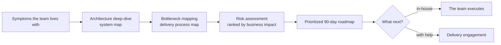

## The rewrite that stalls

Most modernization programmes begin with a decision that sounds reasonable. The monolith has to go, so the team designs its replacement. A target architecture appears, with services, an event bus and a new data model. A year or two later the old system still serves the customers, the new one serves a fraction of them, and both need maintenance.

What went wrong was not the target. It was the order. The team chose where to go before finding out where it was.

A platform that has grown for years carries decisions nobody remembers making. Boundaries exist in the org chart but not in the code. Two services share a database because that was faster once. An integration everybody depends on is documented in one person's head. A target architecture drawn without this knowledge is a guess, and a migration that follows a guess discovers the constraints one incident at a time.

An architecture review puts the discovery first. Its job is to describe the system as it is, find the places where it slows the team down or puts the business at risk, and turn that into an order of work. It is short, two weeks is enough for most platforms, and its output is written, so that later decisions can be checked against it.

## When a review pays for itself

The signal is usually a set of symptoms the team has learned to live with, rather than a verdict on the architecture:

- Releases take days. Manual approvals, long regression cycles, or a single deployable unit that blocks everyone.
- Teams step on each other. Conflicting changes, a shared database and unclear ownership turn every sprint into negotiation.
- Integration failures cascade. One service goes down and takes three others with it, because there are no circuit breakers and no clean contracts.
- Production problems surface through user complaints. The first hour of an incident goes to finding out which service is at fault.
- New hires ramp up slowly. The codebase can be understood only with the knowledge in old colleagues' heads, and the documentation is incomplete or stale.
- Scaling means scaling everything. The busiest parts cannot be scaled on their own, so the whole monolith grows together.

Two or three of these at once mean the platform is shaping the team's delivery, and the team is reacting rather than deciding. That is the moment for an independent look.

Some situations are a poor fit. A simple system with no architectural pressure needs a backlog rather than a review. A team that needs extra hands needs engineers. And where the lowest price decides, a review will lose to a quote that promises a rewrite.

## Four questions the review answers

A useful review is organised around questions rather than around documents. Four of them cover most legacy platforms.

### Where are the boundaries, really?

The first days go to the system as it is: the code, the infrastructure, the data flows, and the people who know them. The output is a system map with the services and modules, the dependencies between them, the shared data stores, and the paths a failure takes when it propagates.

The map is drawn from evidence rather than from the diagram on the wiki. Call graphs, deployment manifests, database schemas and message topics say where the boundaries are. Interviews say why. The difference between the two is usually the first finding.

### Where does delivery slow down?

The second question follows a change from a developer's branch to production. Where does it wait? For a review, for an environment, for a manual test cycle, for a release train? Which steps are automated, and which depend on one person? The output is a process map of the delivery pipeline with the points where releases slow down or get stuck.

This part of the review is often the cheapest to act on. A pipeline bottleneck can be removed in weeks, while a service boundary takes quarters.

### Which debt carries business risk?

Every legacy system has technical debt, and most of it is harmless. The review has to separate the debt that costs money from the debt that merely offends engineers. Single points of failure, undocumented integrations, data consistency gaps between systems, and dependencies on components nobody can patch any more belong in the first group. A module that uses an older pattern but works and rarely changes belongs in the second.

The output is a ranked list of risks, each with the business impact it carries: lost revenue during an outage, a regulatory exposure, a release that cannot ship. Ranking by impact rather than by engineering taste is what makes the list usable by people who do not read code.

### What first?

The last question turns the findings into an order. The output is a roadmap for the next 90 days, sorted by priority, dependency and execution risk. Each item names the symptom it removes and what it needs from the items before it.

Ninety days is deliberate. A longer plan describes a destination. A 90-day plan describes work that can start on Monday and be checked at the end of the quarter.

## Visual: from symptoms to an ordered plan

## How the two weeks go

The method is ordinary. What makes it work is doing all of it, in order, and writing it down.

Interviews with the key developers come first. Each interview asks the same questions: what you would change first, what breaks most often, what nobody wants to touch. The answers converge faster than people expect, and the places where they disagree deserve a closer look.

The system walkthrough follows: the code of the critical services, the infrastructure definitions, the CI/CD configuration and the data flows. Targeted code review in the services the interviews pointed at checks whether the problem is where people think it is.

The delivery pipeline review looks at CI/CD, environments and the handoffs between teams, and follows one change through all of them.

Findings are written down as they appear, so that the second week can go to checking them with the people who know the system and to building the roadmap. The result is a written report and a closing summary for the engineering leadership.

The team provides three things: read access to the repositories, the infrastructure and the pipelines; a few hours of the key developers' time; and someone who can say which business consequences matter most. A review that cannot get these produces a report about the wiki.

## What a usable roadmap looks like

Before accepting a roadmap, read it with four checks.

1. Each item names the symptom it removes. "Introduce an event bus" is a solution looking for a problem. "Stop order updates from failing when the inventory service is slow" is a finding.
2. The first item is small and observable. It should take weeks, and at the end the team should be able to say whether it worked.
3. Dependencies are explicit: which contracts need formalising before a service can be split off, and where observability has to exist before a migration can be measured.
4. Effort is estimated per item, and each estimate says what it assumes.

The roadmap for a legacy platform rarely begins with a service extraction. It begins with the things that make extraction safe: an explicit contract on the boundary that will move, tracing across that boundary so the migration can be measured, and a pipeline that can release the new piece on its own. The strangler fig pattern works because each step is reversible and the old system keeps serving until the new one is proven.

## Running it yourself

A team can run this review on its own platform, and the questions above are the agenda. Two things make it harder from inside. The people who built the system carry its history, and the history explains every decision so well that the problem disappears. And whoever runs the review has to tell colleagues which part of their work is now a risk.

An outside reviewer has no history and no stake in past decisions, which is most of the value. The method is the same either way: map the system from evidence, follow a change through the pipeline, rank the debt by business impact, and write a 90-day plan whose first item is small.

We run this as a fixed two-week engagement, the [software architecture review](/platform-modernization-review). The method does not depend on who runs it.
