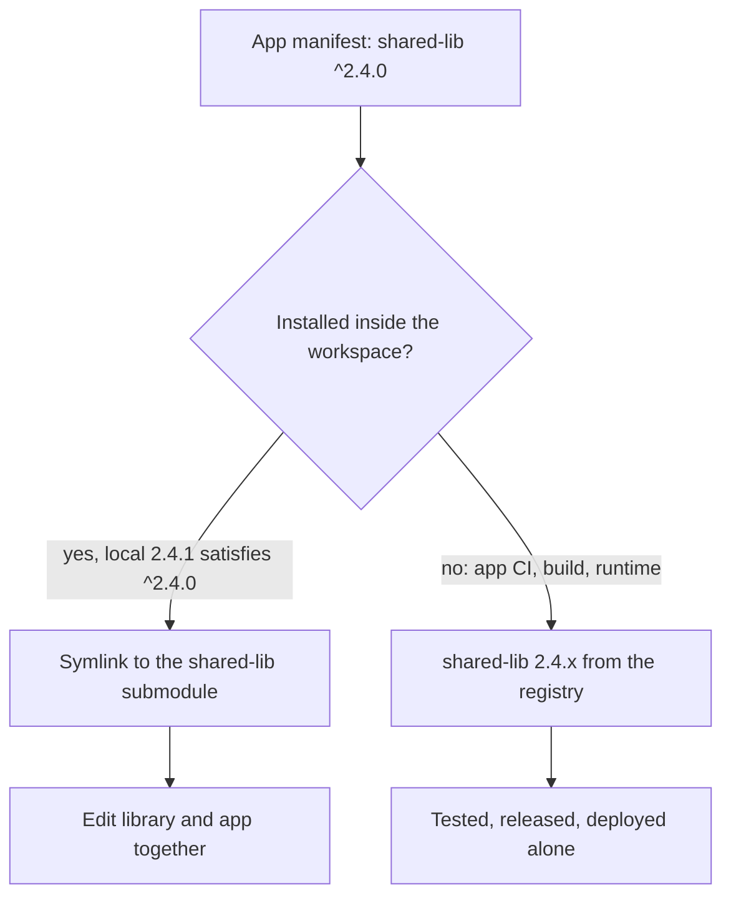

## Two layouts, two sets of costs

A monorepo makes one kind of work easy. A developer changes a shared library and the application that uses it in one checkout and one commit. The package manager links local packages for free, and nobody publishes anything to try an idea.

The costs arrive elsewhere. CI has to work out which of fifty packages a change affects. Packages tend to release together, or need tooling to version them separately. Access is all or nothing: a contractor who needs one service can read all of them. A package that should be shared with a client or published as open source first has to be extracted from a history it was never meant to leave.

Separate repositories invert the trade. Each repository has its own pipeline, release cadence, permissions, and owner. Then a developer needs to change a library and see the effect in an application, and the loop becomes publish a prerelease, bump the consumer, install, test, repeat. The usual shortcut is a hand-made symlink between checkouts, which works until it silently points at the wrong directory.

Most teams pick one layout and live with its costs. A third arrangement keeps every repository independent and borrows only the part of the monorepo that developers miss, the local one.

## The workspace exists only on developer machines

Every package and every application is a complete repository. It installs, builds, tests, releases, and deploys on its own. It depends on its siblings the way it depends on any third-party library: by name and semver range, resolved from a package registry.

A separate, thin workspace repository adds each of those repositories as a git submodule. Next to the submodules it holds one file that tells the package manager which directories are local packages. Inside the workspace, a dependency whose name and range match a local package resolves to that directory through a symlink. A change saved in the library is visible to the application immediately.

Outside the workspace there is no such file. The repository's own CI, the release build, the container image, and production all see a single repository, so the same manifest resolves to the version published in the registry.

The manifest does not change between the two contexts. Only the resolution does.

## Visual: one manifest, two resolutions



## What every repository must do alone

The workspace is only safe if nothing depends on it. Each member repository should pass this test: clone it into an empty directory with no siblings, install, build, and run the tests. If any step fails, the workspace is hiding a dependency, and the first person to notice will be the CI pipeline or a new colleague.

In practice that means:

- dependencies on sibling packages are semver ranges, never relative paths or workspace-only protocols
- the lockfile in the repository is produced by installing that repository on its own
- CI checks out only that repository
- a release publishes a versioned artifact to a registry
- deployment pulls dependencies from the registry, at the versions the lockfile records

The second point is easy to miss with some package managers. pnpm's `workspace:` protocol, for example, refuses to resolve anything except a local workspace package, so a manifest that uses it cannot be installed from a standalone clone. Member manifests should carry ordinary ranges. The workspace then switches linking on: in pnpm that is the `linkWorkspacePackages` setting, which links a local package only when its version satisfies the declared range.

Go reaches the same split by design. A `go.work` file found in a parent directory turns the modules below it into one workspace, and the Go documentation advises against committing `go.work` into module repositories, because CI should test a module the way its consumers will use it. A workspace repository that holds `go.work` above its submodules follows that advice exactly. Cargo's `[patch]` section, placed in the workspace's Cargo configuration, plays the same role for Rust.

## What the workspace repository contains

Very little, and none of it ships.

```text
workspace/
├── .gitmodules            # one entry per member repository
├── pnpm-workspace.yaml    # or go.work, .cargo/config.toml, ...
├── packages/
│   ├── shared-lib/        # submodule
│   └── auth-client/       # submodule
├── apps/
│   ├── admin/             # submodule
│   └── api/               # submodule
└── scripts/bootstrap.sh   # clone, init, install
```

The workspace file is short. With pnpm it lists the directories and enables range-based linking:

```yaml
packages:
  - 'packages/*'
  - 'apps/*'
linkWorkspacePackages: true
```

Local infrastructure fits here as well: compose files for the message broker and the cache, or development-cluster definitions that start every service of one business area together. So do shared editor settings, cross-repository documentation, and instructions for coding agents that work across repositories. Source code, release pipelines, and deployment configuration do not. If the workspace repository ever becomes the place where something is built for production, it has turned into a monorepo with extra steps.

A new developer runs one command:

```bash
git clone --recurse-submodules git@example.com:acme/workspace.git
```

Submodules can also be initialised selectively. Someone working on two services runs `git submodule update --init apps/api packages/shared-lib` and leaves the rest alone. A contractor without access to a repository simply cannot initialise it; the workspace does not widen anyone's permissions.

## Submodule pointers are bookmarks

Git records a specific commit for every submodule. In a repository that builds from submodules, those pointers are critical. In this workspace nothing builds from them, so they only decide what a fresh clone starts from.

One habit needs teaching. After `git submodule update`, each submodule sits on a detached commit rather than a branch. Commits made there are easy to lose. Start every piece of work inside a member with `git switch -c <branch>`, exactly as in a standalone clone, and push from inside that member.

For the same reason, refresh the members by pulling their branches, not by moving them to the recorded commits. Setting `branch = main` for each submodule in `.gitmodules` documents which branch a member follows, and one command brings all of them up to date:

```bash
git submodule foreach 'git switch main && git pull --ff-only'
```

Update the pointers in the workspace repository on a schedule, or let a bot do it. They give a new clone its starting point. What ships is recorded in the registry and in each repository's lockfile.

## Semver decides when the link happens

When the package manager links by range, a local package is linked only if its version satisfies the consumer's range. The range then works as a switch.

While a library receives fixes and backwards-compatible features, its manifest still carries the last released version, say 2.4.1. An application that depends on `^2.4.0` links to the local checkout, and the developer sees library changes immediately.

When the library makes a breaking change and its version moves to 3.0.0, the same application no longer matches. The workspace installs 2.x from the registry for it, and the application keeps working against the version it declared. To adopt 3.0.0, someone changes the application's range on purpose. The workspace never lets an application consume a breaking change that its manifest has not agreed to, which is the same guarantee production has.

Prerelease versions need care: `2.5.0-beta.1` does not satisfy `^2.4.0` under semver rules, so a library carrying a prerelease tag in its manifest stops linking. Keep prerelease numbering in the release process, not in the version a developer works against.

## A change that crosses repositories

Suppose an application needs a new option in a shared library.

1. In the workspace, change the library and the application together. The application runs against the linked library.
2. Open a pull request in the library repository. Its CI installs and tests the library alone. Merge it, and the release publishes 2.5.0.
3. In the application repository, raise the dependency to `^2.5.0`, or let a dependency bot open that pull request. The lockfile is regenerated in the application repository itself.
4. The application's CI installs 2.5.0 from the registry and runs. Merge and deploy.

The cost is the atomic commit. A library change and its consumer change land as two pull requests in order. In exchange, every consumer moves to the new version when it chooses to, and each step is verified against published artifacts rather than against whatever happened to be on a developer's disk. A monorepo commit is atomic, but the deployments that follow it rarely are, so the ordering problem exists there too; it is just less visible.

## Where it goes wrong

The pattern fails in predictable places, and each has a check that catches it.

The most common failure is an application that passes in the workspace and fails in CI. It uses a library feature that exists in the linked checkout but has not been released. A local green result proves nothing until the library is published. Making each repository's standalone CI a required check before merge turns this from a production incident into a red pull request. A small workspace script that lists linked packages whose local source is ahead of their latest published version helps developers see it sooner.

Lockfiles drift. Installing in the workspace writes a workspace-level lockfile, while each member's CI uses the member's own lockfile; npm, for instance, does not update member lockfiles during a workspace install at all. Regenerate a member's lockfile by installing in that member with workspaces turned off, and run CI installs in frozen mode so that a stale lockfile fails loudly. A member lockfile should never contain links to sibling directories.

Linked packages need build output. A consumer usually imports the library's compiled output, which a fresh checkout does not have. Either run the library's build in watch mode, or have the package expose its source under a development-only export condition that the workspace's tooling resolves and published builds ignore.

Some dependencies must exist once per process, such as a UI framework or an ORM. A symlinked package can resolve its own copy from its own directory, and two copies load. Declare such libraries as peer dependencies and let the workspace hoist or deduplicate them.

## When a monorepo is the better fit

This arrangement suits code with independent owners, independent release cadences, different access rules, or consumers outside your own applications. If every package always releases together, most changes touch many packages at once, and one team owns all of it, a monorepo with graph-aware build tooling is simpler. Choosing a submodule workspace there adds a release step to every change and buys nothing.

It also changes what an automated contributor sees. A coding agent working inside one member repository gets a complete, self-contained unit with its own tests and its own CI gate. Working from the workspace, it can read across repositories while every change it proposes still has to pass the standalone checks of the repository it touches.

## Starting from what you have

If your packages already live in separate repositories:

1. Pick one library and one application that change together often.
2. Run the empty-directory test on both: clone alone, install, build, test. Fix whatever depends on a sibling path.
3. Create a workspace repository, add both as submodules, and enable range-based linking in the package manager.
4. Make each repository's standalone CI a required check, and run installs there with a frozen lockfile.
5. Add the remaining repositories once the first pair has gone through a full release cycle.

If you are starting from a monorepo, the same test tells you which packages are ready to leave: the ones that already install, build, and test on their own.

The workspace is a development tool. Releases and deployments still come from each repository and from the registry, so a broken workspace slows down local work without affecting what ships.
