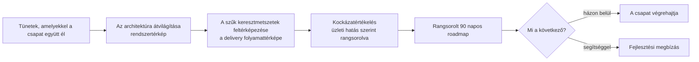

## Az újraírás, amely elakad

Sok modernizációs program ésszerűnek hangzó döntéssel kezdődik. A monolitnak mennie kell, ezért a csapat megtervezi az utódját. Elkészül a célarchitektúra szolgáltatásokkal, event busszal és új adatmodellel. Egy-két évvel később a régi rendszer még mindig kiszolgálja az ügyfeleket, az új a töredéküket, és mindkettőt karban kell tartani.

Nem a cél volt rossz, hanem a sorrend. A csapat eldöntötte, hová megy, mielőtt kiderítette volna, hol áll.

Az évek óta növekvő rendszer tele van olyan döntésekkel, amelyekre már senki nem emlékszik. A határok a szervezeti ábrán léteznek, a kódban nem. Két szolgáltatás közös adatbázist használ, mert egyszer az volt a gyorsabb. Az integráció, amelytől mindenki függ, csak egyetlen kolléga fejében van meg. Az ilyen tudás nélkül rajzolt célarchitektúra találgatás, és a találgatásra épülő migráció incidensről incidensre fedezi fel a valódi korlátokat.

Az architektúrareview a feltárást teszi az első helyre. Leírjuk a rendszer jelenlegi működését, feltárjuk, hol lassítja a csapatot, vagy hol jelent üzleti kockázatot, és meghatározzuk a teendők sorrendjét. Rövid: mi két hét alatt végezzük el. Az eredménye írásos, hogy a későbbi döntéseket össze lehessen vetni vele.

## Mikor térül meg a review

A review szükségességét többnyire olyan tünetek jelzik, amelyekkel a csapat megtanult együtt élni:

- A release napokig tart. Kézi jóváhagyások, hosszú regressziós tesztkörök vagy egyetlen deployolható egység, amely mindenkit blokkol.
- A csapatok akadályozzák egymást. Ütköző módosítások, közös adatbázis és tisztázatlan felelősségi körök miatt minden sprint egyeztetéssé válik.
- Az integrációs hibák továbbgyűrűznek. Ha egy szolgáltatás leáll, magával ránt még hármat, mert nincs circuit breaker, és nincsenek tiszta contractok.
- Az éles hibákról a felhasználóktól értesül a csapat. Az incidens első órája azzal telik, hogy kiderüljön, melyik szolgáltatás a hibás.
- Az új kollégák lassan kapcsolódnak be. A kódbázis csak a régi kollégák fejében lévő tudással érthető, a dokumentáció hiányos vagy elavult.
- A skálázás mindent érint. A leginkább terhelt részeket nem lehet külön skálázni, az egész monolitnak együtt kell nőnie.

Ha ezek közül kettő-három egyszerre igaz, akkor a rendszer szabja meg a csapat delivery-jét, és a csapat reagál, ahelyett hogy döntene. Ilyenkor van szükség független nézőpontra.

Vannak helyzetek, ahová a review nem való. Egyszerű rendszernél, ahol nincs architekturális nyomás, elég a backlog. Annak a csapatnak, amelyik csak plusz fejlesztői kapacitást keres, fejlesztők kellenek. És ahol a legalacsonyabb ár dönt, a review veszít az újraírást ígérő árajánlattal szemben.

## Négy kérdés, amelyre a review válaszol

A review négy kérdésre épül.

### Hol vannak a határok valójában?

Az első napokban a rendszer jelenlegi állapotát tárjuk fel: megvizsgáljuk a kódot, az infrastruktúrát és a data flow-kat, és beszélünk azokkal, akik ismerik a rendszert. Az eredmény rendszertérkép a szolgáltatásokkal és modulokkal, a köztük lévő függőségekkel, a közös adattárakkal és a hibák terjedési útjaival.

A térképet bizonyítékokból rajzoljuk meg: a hívási gráfok, a deployment manifestek, az adatbázissémák és az üzenettopicok megmondják, hol vannak a határok. Az interjúk megmondják, miért. A kettő közti különbség rendszerint az első megállapítás.

### Hol lassul le a delivery?

A második kérdés megválaszolásához végigkövetünk egy módosítást a fejlesztő branchétől az éles üzemig. Hol várakozik? Review-ra, környezetre, kézi tesztkörre, a következő ütemezett release-re? Mely lépések automatizáltak, és melyek függenek egyetlen embertől? Az eredmény a delivery pipeline folyamattérképe azokkal a pontokkal, ahol a release-ek lelassulnak vagy elakadnak.

Gyakran a review-nak ez a része hozza a legolcsóbban megvalósítható lépéseket. Egy szűk keresztmetszetet a pipeline-ban hetek alatt is meg lehet szüntetni, míg egy service boundary áthelyezése negyedévekig is tarthat.

### Melyik adósság hordoz üzleti kockázatot?

Minden legacy rendszerben van technikai adósság, és nem kell az egészet megszüntetni. A review-nak szét kell választania azt az adósságot, amelyik pénzbe kerül, attól, amelyik csak a mérnököket zavarja. Az első csoportba tartoznak az egyetlen hibaponttól függő részek, a dokumentálatlan integrációk, a rendszerek közti adatkonzisztencia-hiányok és az olyan komponensektől való függés, amelyeket már senki nem tud javítani. A másodikba az a modul, amelyik régebbi mintát követ, de működik, és ritkán változik.

Az eredmény rangsorolt kockázati lista, minden tételnél az üzleti hatással: leállás alatt kieső bevétel, szabályozói kitettség, release, amelyet nem lehet kiadni. Ha üzleti hatás szerint rangsoroljuk a kockázatokat, azok is tudják használni a listát, akik nem olvasnak kódot.

### Mi legyen az első?

Az utolsó kérdés sorrendbe állítja a megállapításokat. Az eredmény a következő 90 nap roadmapje, prioritás, függőség és végrehajtási kockázat szerint sorba állítva. Minden tételnél leírjuk, milyen tünetet szüntet meg, és mely korábbi tételektől függ.

A 90 napos terv olyan munkát ír le, amelyet hétfőn el lehet kezdeni, és a negyedév végén ellenőrizni lehet.

## Vizuál: a tünetektől a sorba állított tervig

## Hogyan telik a két hét

Először interjút készítünk a kulcsfejlesztőkkel. Mindegyikben ugyanazok a kérdések hangzanak el: mit kellene először megváltoztatni, mi romlik el a leggyakrabban, mihez nem nyúl senki szívesen. A válaszok hamarabb mutatnak egy irányba, mint várnánk, és ahol eltérnek, ott érdemes közelebbről megnézni a rendszert.

Ezt követi a rendszerbejárás: a kritikus szolgáltatások kódja, az infrastruktúra definíciói, a CI/CD-konfiguráció és a data flow-k. Az interjúk alapján kiválasztott szolgáltatásokban célzott code review-val ellenőrizzük, hogy valóban ott van-e a probléma, ahol a csapat gondolja.

A delivery pipeline áttekintésekor megvizsgáljuk a CI/CD-t, a környezeteket és a csapatok közti átadásokat, és mindegyiken végigkövetünk egy módosítást.

A megállapításokat rögtön leírjuk. Így a második héten a rendszert ismerő kollégákkal ellenőrizhetjük őket, és összeállíthatjuk a roadmapet. Az eredmény írásos review-anyag és záró vezetői összefoglaló.

A csapattól három dolog kell: olvasási hozzáférés a repókhoz, az infrastruktúrához és a pipeline-okhoz; néhány óra a kulcsfejlesztők idejéből; és valaki, aki meg tudja mondani, melyik üzleti következmény számít a legjobban.

## Milyen a használható roadmap

Mielőtt elfogadnánk egy roadmapet, olvassuk végig négy szempont szerint.

1. Minden tétel megnevezi a tünetet, amelyet megszüntet. Az „Event bus bevezetése” megoldás, amely problémát keres magának. A „Ne bukjon el a rendelés frissítése, ha a készletszolgáltatás lassú” megnevezi a tünetet.
2. Az első tétel kicsi és mérhető. Heteket vesz igénybe, és a végén a csapat meg tudja mondani, működött-e.
3. A függőségek explicitek: mely contractokat kell formalizálni, mielőtt egy szolgáltatást le lehet választani, és hol kell observability, mielőtt egy migrációt mérni lehet.
4. A ráfordítást tételenként becsüljük, és minden becslés megmondja, mit feltételez.

A legacy rendszer roadmapje többnyire azzal kezdődik, ami egy szolgáltatás leválasztását biztonságossá teszi: explicit contract azon a határon, amelyik mozogni fog, tracing a határon át, hogy a migrációt mérni lehessen, és pipeline, amely az új részt önállóan tudja release-elni. A strangler fig-minta azért működik, mert a régi rendszer tovább szolgál ki, miközben az új darabonként átveszi a funkcióit.

## Ha magunk csináljuk

A csapat a saját rendszerén is elvégezheti ezt a review-t, és a fenti kérdések adják a napirendet. Belülről két dolog nehezíti. Akik a rendszert építették, ismerik a korábbi döntések okait, és emiatt nehezebben veszik észre a mai kockázatokat. És aki a review-t vezeti, annak a kollégáinak kell megmondania, hogy a munkájuk melyik része lett kockázat.

A külső szakértő munkájának értékét nagyrészt az adja, hogy nem kötődik a rendszer múltjához, és nem érintett a korábbi döntésekben. A módszer mindkét esetben ugyanaz: bizonyítékból térképezzük fel a rendszert, kövessünk végig egy módosítást a pipeline-on, rangsoroljuk az adósságot üzleti hatás szerint, és írjunk 90 napos tervet, amelynek az első tétele kicsi.

Mi ezt kéthetes, előre rögzített feladatú megbízásként végezzük: ez az [architektúrareview](/hu/platform-modernization-review).
