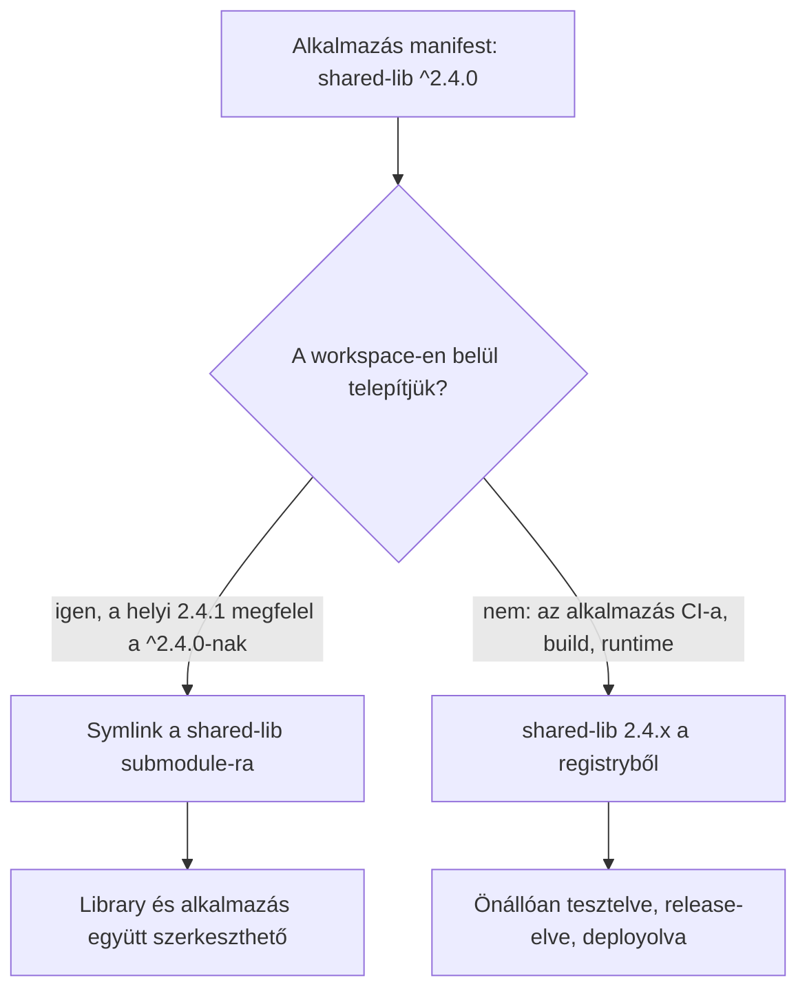

## Két felépítés, kétféle költség

A monorepo egyfajta munkát nagyon megkönnyít. A fejlesztő egy checkoutban, egy commitban módosíthat egy közös library-t és az azt használó alkalmazást. A package manager magától összelinkeli a helyi package-eket, és egy ötlet kipróbálásához senkinek nem kell semmit publikálnia.

A költség máshol jelentkezik. A CI-nak ki kell találnia, hogy ötven package közül melyiket érinti egy változás. A package-ek hajlamosak együtt release-elődni, vagy külön eszköz kell a független verziózásukhoz. A hozzáférés a mindent vagy semmit elvén működik: az a külsős, akinek egy service kell, mindegyiket olvashatja. Ha egy package-et meg akarunk osztani egy ügyféllel, vagy open source-ként kiadnánk, előbb le kell választani egy olyan historyról, amelyből soha nem tervezték kiemelni.

A külön repók fordítva osztják el a terhet. Minden repónak saját pipeline-ja, release-ütemezése, jogosultságai és gazdája van. Aztán módosítani kell egy library-t, és megnézni a hatását egy alkalmazásban, és a kör így néz ki: prerelease publikálása, a consumer verziójának emelése, telepítés, teszt, és elölről. A szokásos kerülőút egy kézzel készített symlink a két checkout között, ami addig működik, amíg csendben rossz könyvtárra nem kezd mutatni.

A legtöbb csapat választ egy felépítést, és együtt él a költségeivel. Van egy harmadik elrendezés is: minden repó független marad, és a monorepóból csak azt a részt vesszük át, amelyik a fejlesztőknek hiányzik, a helyit.

## A workspace csak a fejlesztők gépén létezik

Minden package és minden alkalmazás teljes értékű repó. Önállóan telepíthető, buildelhető, tesztelhető, release-elhető és deployolható. A testvérrepóktól ugyanúgy függ, mint bármelyik külső library-től: név és semver tartomány alapján, egy package registryből.

Egy külön, vékony workspace repó git submodule-ként tartalmazza ezeket a repókat. A submodule-ok mellett van benne egy fájl, amely megmondja a package managernek, mely könyvtárak helyi package-ek. A workspace-en belül az a függőség, amelynek a neve és a tartománya illeszkedik egy helyi package-re, symlinken keresztül arra a könyvtárra oldódik fel. Amit a library-ben elmentünk, azt az alkalmazás azonnal látja.

A workspace-en kívül ez a fájl nem létezik. A repó saját CI-a, a release build, a container image és az éles környezet egyetlen repót lát, így ugyanaz a manifest a registryben publikált verzióra oldódik fel.

A manifest a két környezetben ugyanaz. Csak a feloldás más.

## Vizuál: egy manifest, kétféle feloldás



## Amit minden repónak egyedül is tudnia kell

A workspace csak akkor biztonságos, ha semmi nem függ tőle. Minden tagrepónak át kell mennie ezen a teszten: klónozzuk egy üres könyvtárba, testvérrepók nélkül, telepítsük, buildeljük, futtassuk a teszteket. Ha bármelyik lépés elbukik, a workspace elrejt egy függőséget, és először a CI pipeline vagy egy új kolléga fog belefutni.

A gyakorlatban ez a következőket jelenti:

- a testvér package-ekre semver tartománnyal hivatkozunk, soha nem relatív útvonallal vagy csak workspace-ben működő protokollal
- a repó lockfile-ja a repó önálló telepítéséből keletkezik
- a CI csak az adott repót checkoutolja
- a release verziózott artifactot publikál egy registrybe
- a deploy a registryből húzza a függőségeket, a lockfile-ban rögzített verziókon

A második pont egyes package managereknél könnyen elsikkad. A pnpm `workspace:` protokollja például kizárólag helyi workspace package-re hajlandó feloldani, így az ezt használó manifest önálló klónból nem telepíthető. A tagrepók manifestjeiben ezért közönséges tartományok álljanak. A linkelést a workspace kapcsolja be: pnpm-ben ez a `linkWorkspacePackages` beállítás, amely csak akkor linkel egy helyi package-et, ha a verziója megfelel a megadott tartománynak.

A Go eleve így működik. A szülőkönyvtárban talált `go.work` fájl az alatta lévő modulokat egy workspace-szé fogja össze, a Go dokumentációja pedig azt tanácsolja, hogy a `go.work` ne kerüljön be a modulok repójába, mert a CI-nak úgy kell tesztelnie a modult, ahogy a consumerei használják. Ha a `go.work` a workspace repóban, a submodule-ok fölött van, pontosan ezt a tanácsot követjük. Rustban ugyanezt a szerepet a workspace Cargo-konfigurációjában elhelyezett `[patch]` szekció tölti be.

## Mi van a workspace repóban

Nagyon kevés, és semmi nem kerül belőle élesbe.

```text
workspace/
├── .gitmodules            # tagrepónként egy bejegyzés
├── pnpm-workspace.yaml    # vagy go.work, .cargo/config.toml, ...
├── packages/
│   ├── shared-lib/        # submodule
│   └── auth-client/       # submodule
├── apps/
│   ├── admin/             # submodule
│   └── api/               # submodule
└── scripts/bootstrap.sh   # klónozás, init, telepítés
```

A workspace fájl rövid. pnpm esetén felsorolja a könyvtárakat, és bekapcsolja a tartomány alapú linkelést:

```yaml
packages:
  - 'packages/*'
  - 'apps/*'
linkWorkspacePackages: true
```

Ide tartozik a helyi infrastruktúra is: compose fájlok a message brokerhez és a cache-hez, vagy fejlesztői cluster-definíciók, amelyek egy üzleti terület összes service-ét együtt indítják. Ugyanígy a közös editor-beállítások, a repókon átívelő dokumentáció és a több repón dolgozó coding agentek instrukciói. Forráskód, release pipeline és deploy-konfiguráció viszont nem. Ha a workspace repóban egyszer csak élesbe szánt build készül, az már egy monorepo, csak több lépéssel.

Egy új fejlesztőnek egyetlen parancs kell:

```bash
git clone --recurse-submodules git@example.com:acme/workspace.git
```

A submodule-ok szelektíven is inicializálhatók. Aki két service-en dolgozik, lefuttatja a `git submodule update --init apps/api packages/shared-lib` parancsot, a többit pedig békén hagyja. Az a külsős, akinek nincs hozzáférése egy repóhoz, egyszerűen nem tudja inicializálni; a workspace senkinek nem bővíti a jogosultságait.

## A submodule pointerek csak könyvjelzők

A git minden submodule-hoz egy konkrét commitot rögzít. Egy olyan repóban, amely submodule-okból buildel, ezek a pointerek kritikusak. Ebben a workspace-ben semmi nem buildel belőlük, így csak azt döntik el, honnan indul egy friss klón.

Egy szokást meg kell tanítani. A `git submodule update` után minden submodule detached commiton áll, nem branchen. Az itt készült commitok könnyen elvesznek. A tagrepón belül minden munkát `git switch -c <branch>` paranccsal kezdjünk, pontosan úgy, mint egy önálló klónban, és a tagrepón belülről pusholjunk.

Ugyanezért a tagrepókat a branchük pullolásával frissítsük, ne a rögzített commitokra állítással. Ha a `.gitmodules` fájlban minden submodule-nál megadjuk a `branch = main` értéket, dokumentáljuk, melyik branchet követi, és egyetlen paranccsal mindegyiket frissíthetjük:

```bash
git submodule foreach 'git switch main && git pull --ff-only'
```

A workspace repó pointereit frissítsük ütemezetten, vagy bízzuk egy botra. Egy új klón ezekből indul. Hogy mi kerül élesbe, azt a registry és az egyes repók lockfile-ja rögzíti.

## A semver dönti el, mikor jön létre a link

Ha a package manager tartomány alapján linkel, egy helyi package-et csak akkor linkel, ha a verziója megfelel a consumer tartományának. A tartomány így kapcsolóként működik.

Amíg egy library javításokat és visszafelé kompatibilis új funkciókat kap, a manifestjében még az utolsó release-elt verzió áll, mondjuk 2.4.1. Az az alkalmazás, amely `^2.4.0`-tól függ, a helyi checkoutra linkel, és a fejlesztő azonnal látja a library változásait.

Amikor a library breaking change-et vezet be, és a verziója 3.0.0-ra lép, ugyanez az alkalmazás már nem illeszkedik. A workspace a 2.x verziót telepíti neki a registryből, az alkalmazás pedig tovább működik azzal a verzióval, amelyet deklarált. A 3.0.0 átvételéhez valakinek szándékosan módosítania kell az alkalmazás tartományát. A workspace soha nem enged egy alkalmazásnak olyan breaking change-et, amelyet a manifestje nem fogadott el, és élesben is pontosan ez a garancia.

A prerelease verziókkal óvatosan kell bánni: a `2.5.0-beta.1` a semver szabályai szerint nem felel meg a `^2.4.0` tartománynak, így az a library, amelynek a manifestjében prerelease tag áll, nem linkelődik többé. A prerelease számozás maradjon a release folyamatban, ne abban a verzióban, amelyen a fejlesztő dolgozik.

## Repókon átívelő változás

Tegyük fel, hogy egy alkalmazásnak új opció kell egy közös library-ben.

1. A workspace-ben együtt módosítjuk a library-t és az alkalmazást. Az alkalmazás a linkelt library-vel fut.
2. Pull requestet nyitunk a library repójában. A CI önmagában telepíti és teszteli a library-t. Merge után a release publikálja a 2.5.0-t.
3. Az alkalmazás repójában `^2.5.0`-ra emeljük a függőséget, vagy egy dependency bot nyitja meg ezt a pull requestet. A lockfile magában az alkalmazás repójában generálódik újra.
4. Az alkalmazás CI-a a registryből telepíti a 2.5.0-t, és lefut. Merge és deploy.

Az ár az atomi commit. A library változása és a consumer változása két pull requestként, sorrendben kerül be. Cserébe minden consumer akkor áll át az új verzióra, amikor ő maga dönt így, és minden lépést publikált artifactok ellenőriznek, nem az, ami épp a fejlesztő lemezén volt. Egy monorepo commit atomi, de az utána következő deployok ritkán azok, vagyis a sorrend problémája ott is létezik, csak kevésbé látszik.

## Ahol elcsúszik

A minta kiszámítható helyeken hibázik, és mindegyikre van ellenőrzés.

A leggyakoribb hiba az alkalmazás, amely a workspace-ben zöld, a CI-ban piros. Olyan library-funkciót használ, amely a linkelt checkoutban megvan, de még nem jelent meg release-ben. A helyi zöld eredmény semmit nem bizonyít, amíg a library-t nem publikálták. Ha minden repó önálló CI-a kötelező check merge előtt, ebből éles incidens helyett piros pull request lesz. Egy kis workspace-script, amely kilistázza azokat a linkelt package-eket, amelyeknek a helyi forrása előrébb jár a legutóbb publikált verziónál, segít ezt hamarabb észrevenni.

A lockfile-ok elcsúsznak. A workspace-ben futó telepítés workspace-szintű lockfile-t ír, a tagrepók CI-a viszont a tagrepó saját lockfile-ját használja; az npm például workspace-telepítéskor egyáltalán nem frissíti a tagok lockfile-jait. A tagrepó lockfile-ját a tagrepóban, kikapcsolt workspace-szel futó telepítés generálja újra, a CI pedig frozen módban telepítsen, hogy az elavult lockfile hangosan bukjon el. A tagrepó lockfile-jában soha ne legyen link testvérkönyvtárra.

A linkelt package-eknek build output kell. A consumer általában a library lefordított kimenetét importálja, ami egy friss checkoutban nincs meg. Vagy watch módban fusson a library buildje, vagy a package egy csak fejlesztéshez használt export conditionnel tegye elérhetővé a forrását, amelyet a workspace eszközei feloldanak, a publikált buildek pedig figyelmen kívül hagynak.

Bizonyos függőségekből folyamatonként csak egy példány lehet, ilyen egy UI framework vagy egy ORM. Egy symlinkelt package a saját könyvtárából is feloldhatja a saját példányát, és máris kettő töltődik be. Az ilyen library-ket peer dependency-ként deklaráljuk, és bízzuk a workspace-re a hoistolást vagy a deduplikálást.

## Mikor jobb a monorepo

Ez az elrendezés olyan kódhoz illik, amelynek független gazdái, független release-ütemezése, eltérő hozzáférési szabályai vagy a saját alkalmazásainkon kívüli consumerei vannak. Ha minden package mindig együtt release-elődik, a legtöbb változás egyszerre sok package-et érint, és egyetlen csapat birtokolja az egészet, akkor egy monorepo a függőségi gráfot értő build eszközökkel egyszerűbb. Ott a submodule workspace minden változáshoz egy release-lépést ad, és semmit nem nyerünk vele.

Azt is megváltoztatja, mit lát egy automatizált közreműködő. Egy tagrepóban dolgozó coding agent teljes, önmagában zárt egységet kap, saját tesztekkel és saját CI-kapuval. A workspace-ből dolgozva több repón át is olvashat, miközben minden javasolt változásának át kell mennie annak a repónak az önálló ellenőrzésein, amelyet érint.

## Kiindulás abból, ami van

Ha a package-ek már külön repókban vannak:

1. Válasszunk egy library-t és egy alkalmazást, amelyek gyakran változnak együtt.
2. Futtassuk le mindkettőn az üres könyvtáras tesztet: önálló klón, telepítés, build, teszt. Javítsunk ki mindent, ami testvérrepó útvonalára támaszkodik.
3. Hozzunk létre egy workspace repót, vegyük fel mindkettőt submodule-ként, és kapcsoljuk be a package managerben a tartomány alapú linkelést.
4. Tegyük kötelező checkké minden repó önálló CI-át, és ott frozen lockfile-lal telepítsünk.
5. A többi repót akkor vegyük fel, amikor az első pár már végigment egy teljes release cikluson.

Ha monorepóból indulunk, ugyanez a teszt megmutatja, mely package-ek állnak készen a kiköltözésre: azok, amelyek már most is önállóan telepíthetők, buildelhetők és tesztelhetők.

A workspace fejlesztői eszköz. A release-ek és a deployok továbbra is az egyes repókból és a registryből jönnek, így egy elromlott workspace lassítja a helyi munkát, de nem érinti azt, ami élesbe megy.
